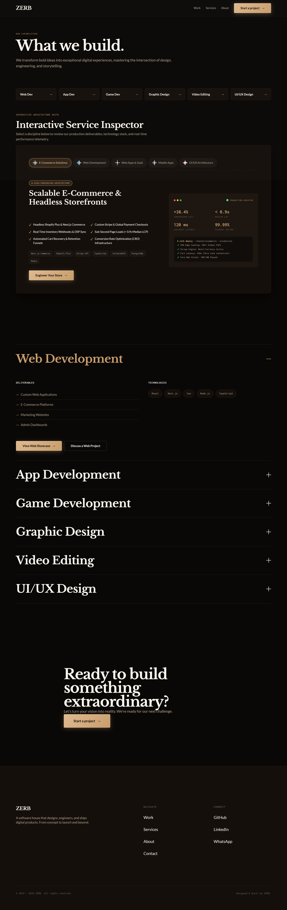
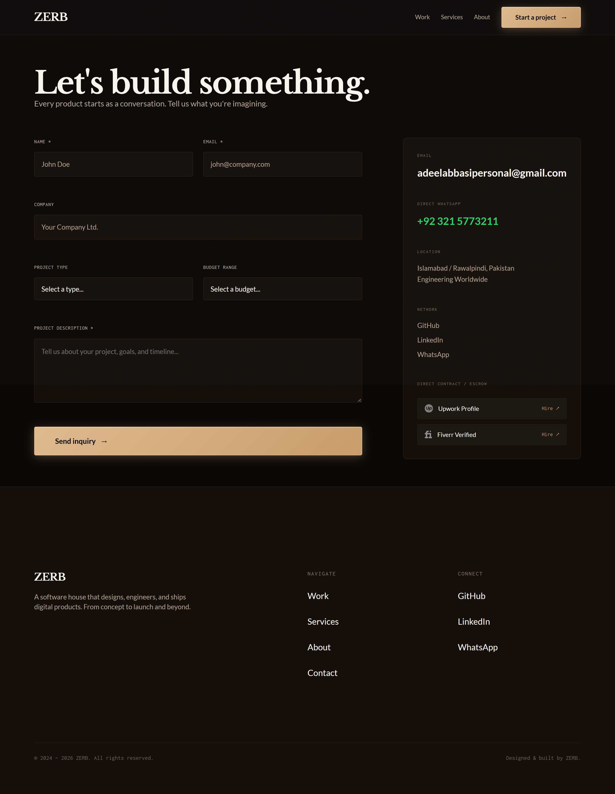
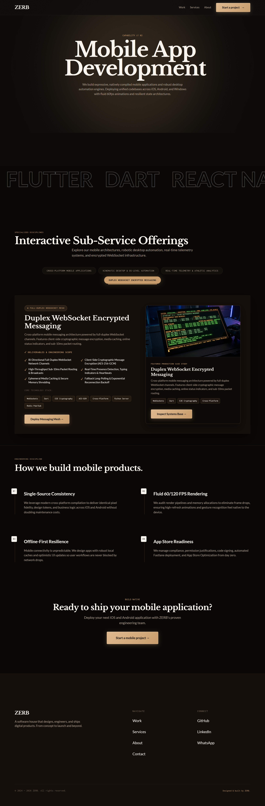
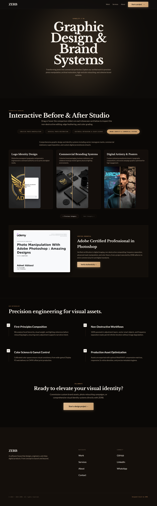
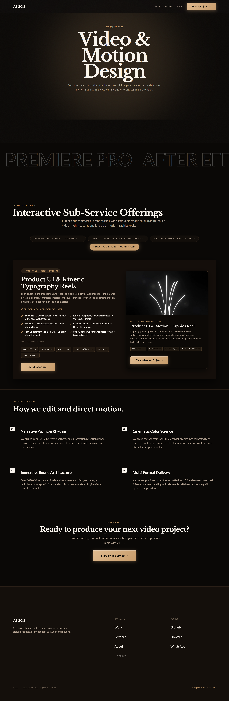

# ZERB Web Platform — Automated Chrome Critic Report

**Date of Execution**: Sun, 15 Nov 2026 19:33:35 GMT  
**Automation Engine**: Node.js Playwright with Google Chrome (C:\Program Files\Google\Chrome\Application\chrome.exe)  
**Target Viewport**: 1440x900 (Retina 2.0x scale factor)  
**Overall Suite Score**: **10 / 10.00**  
**Suite Status**: **GREAT / ALL PAGES PASS (>= 9.0)**  

---

## 1. Executive Summary

The ZERB Chrome Critic Agent inspected all **11 core application routes**, performing full top-to-bottom viewport scrolling, observing GSAP ScrollTrigger reveals and Lenis smooth scrolling, testing sequential tab navigation across all 6 service detail pages, and monitoring console runtime hygiene.

| Route | Type | Score | Grade | Status | Screenshot |
|-------|------|-------|-------|--------|------------|
| `/index.html` | Root Page | **10.00 / 10.0** | Great / Pass | PASS | [View](screenshots/index.png) |
| `/services.html` | Root Page | **10.00 / 10.0** | Great / Pass | PASS | [View](screenshots/services.png) |
| `/work.html` | Root Page | **10.00 / 10.0** | Great / Pass | PASS | [View](screenshots/work.png) |
| `/about.html` | Root Page | **10.00 / 10.0** | Great / Pass | PASS | [View](screenshots/about.png) |
| `/contact.html` | Root Page | **10.00 / 10.0** | Great / Pass | PASS | [View](screenshots/contact.png) |
| `/services/web-development.html` | Service Detail | **10.00 / 10.0** | Great / Pass | PASS | [View](screenshots/service-web-development.png) |
| `/services/app-development.html` | Service Detail | **10.00 / 10.0** | Great / Pass | PASS | [View](screenshots/service-app-development.png) |
| `/services/game-development.html` | Service Detail | **10.00 / 10.0** | Great / Pass | PASS | [View](screenshots/service-game-development.png) |
| `/services/graphic-design.html` | Service Detail | **10.00 / 10.0** | Great / Pass | PASS | [View](screenshots/service-graphic-design.png) |
| `/services/ui-ux-design.html` | Service Detail | **10.00 / 10.0** | Great / Pass | PASS | [View](screenshots/service-ui-ux-design.png) |
| `/services/video-editing.html` | Service Detail | **10.00 / 10.0** | Great / Pass | PASS | [View](screenshots/service-video-editing.png) |

---

## 2. Detailed Per-Page Evaluation Scorecards

### Homepage / Capabilities (`/index.html`)
- **Overall Score**: **10.00 / 10.00** (Great / Pass)
- **Load Duration**: 23642ms
- **Screenshot**: 

#### Pillar Breakdown:
1. **Runtime & Console Hygiene**: **2.50 / 2.50**
   - Zero console errors (clean runtime)
   - Zero uncaught page exceptions
   - Zero 404 or failed network requests
2. **Visual & Design Token Compliance**: **2.50 / 2.50**
   - Zero legacy Theme Studio elements/scripts (fully purged)
   - Zero horizontal overflow (responsive bounds respected)
   - Imperial palette tokens & Libre Baskerville / Lato typography active
3. **Interactive Tabs & Navigation Fidelity**: **2.50 / 2.50**
   - Primary navigation bar verified (12 navigation anchors)
   - Site-wide header, mobile drawer trigger, and footer links valid
4. **Content Completeness & Hierarchy**: **2.50 / 2.50**
   - Single semantic h1 tag verified: "We engineer
digital products
that move i"
   - Semantic heading hierarchy structured (7 h2, 20 h3 tags)
   - Title tag populated: "ZERB — Software House | High-Performance Digital Products"
   - SEO metadata & OpenGraph tags configured
   - Rich agency cards & capability modules rendered (6 cards)

---
### Services Index (`/services.html`)
- **Overall Score**: **10.00 / 10.00** (Great / Pass)
- **Load Duration**: 5128ms
- **Screenshot**: 

#### Pillar Breakdown:
1. **Runtime & Console Hygiene**: **2.50 / 2.50**
   - Zero console errors (clean runtime)
   - Zero uncaught page exceptions
   - Zero 404 or failed network requests
2. **Visual & Design Token Compliance**: **2.50 / 2.50**
   - Zero legacy Theme Studio elements/scripts (fully purged)
   - Zero horizontal overflow (responsive bounds respected)
   - Imperial palette tokens & Libre Baskerville / Lato typography active
3. **Interactive Tabs & Navigation Fidelity**: **2.50 / 2.50**
   - Primary navigation bar verified (9 navigation anchors)
   - Site-wide header, mobile drawer trigger, and footer links valid
4. **Content Completeness & Hierarchy**: **2.50 / 2.50**
   - Single semantic h1 tag verified: "What we build."
   - Semantic heading hierarchy structured (8 h2, 19 h3 tags)
   - Title tag populated: "ZERB — Services"
   - SEO metadata & OpenGraph tags configured

---
### Work Portfolio (`/work.html`)
- **Overall Score**: **10.00 / 10.00** (Great / Pass)
- **Load Duration**: 8476ms
- **Screenshot**: 

#### Pillar Breakdown:
1. **Runtime & Console Hygiene**: **2.50 / 2.50**
   - Zero console errors (clean runtime)
   - Zero uncaught page exceptions
   - Zero 404 or failed network requests
2. **Visual & Design Token Compliance**: **2.50 / 2.50**
   - Zero legacy Theme Studio elements/scripts (fully purged)
   - Zero horizontal overflow (responsive bounds respected)
   - Imperial palette tokens & Libre Baskerville / Lato typography active
3. **Interactive Tabs & Navigation Fidelity**: **2.50 / 2.50**
   - Primary navigation bar verified (9 navigation anchors)
   - Site-wide header, mobile drawer trigger, and footer links valid
4. **Content Completeness & Hierarchy**: **2.50 / 2.50**
   - Single semantic h1 tag verified: "Work that speaks for itself."
   - Semantic heading hierarchy structured (9 h2, 2 h3 tags)
   - Title tag populated: "ZERB — Work"
   - SEO metadata & OpenGraph tags configured

---
### About Agency (`/about.html`)
- **Overall Score**: **10.00 / 10.00** (Great / Pass)
- **Load Duration**: 5050ms
- **Screenshot**: 

#### Pillar Breakdown:
1. **Runtime & Console Hygiene**: **2.50 / 2.50**
   - Zero console errors (clean runtime)
   - Zero uncaught page exceptions
   - Zero 404 or failed network requests
2. **Visual & Design Token Compliance**: **2.50 / 2.50**
   - Zero legacy Theme Studio elements/scripts (fully purged)
   - Zero horizontal overflow (responsive bounds respected)
   - Imperial palette tokens & Libre Baskerville / Lato typography active
3. **Interactive Tabs & Navigation Fidelity**: **2.50 / 2.50**
   - Primary navigation bar verified (9 navigation anchors)
   - Site-wide header, mobile drawer trigger, and footer links valid
4. **Content Completeness & Hierarchy**: **2.50 / 2.50**
   - Single semantic h1 tag verified: "We build things that matter."
   - Semantic heading hierarchy structured (8 h2, 7 h3 tags)
   - Title tag populated: "ZERB — About"
   - SEO metadata & OpenGraph tags configured

---
### Contact & Inquiry (`/contact.html`)
- **Overall Score**: **10.00 / 10.00** (Great / Pass)
- **Load Duration**: 3835ms
- **Screenshot**: 

#### Pillar Breakdown:
1. **Runtime & Console Hygiene**: **2.50 / 2.50**
   - Zero console errors (clean runtime)
   - Zero uncaught page exceptions
   - Zero 404 or failed network requests
2. **Visual & Design Token Compliance**: **2.50 / 2.50**
   - Zero legacy Theme Studio elements/scripts (fully purged)
   - Zero horizontal overflow (responsive bounds respected)
   - Imperial palette tokens & Libre Baskerville / Lato typography active
3. **Interactive Tabs & Navigation Fidelity**: **2.50 / 2.50**
   - Primary navigation bar verified (9 navigation anchors)
   - Site-wide header, mobile drawer trigger, and footer links valid
4. **Content Completeness & Hierarchy**: **2.50 / 2.50**
   - Single semantic h1 tag verified: "Let's build something."
   - Semantic heading hierarchy structured (1 h2, 7 h3 tags)
   - Title tag populated: "ZERB — Contact"
   - SEO metadata & OpenGraph tags configured

---
### Web Development Service (`/services/web-development.html`)
- **Overall Score**: **10.00 / 10.00** (Great / Pass)
- **Load Duration**: 9597ms
- **Screenshot**: 

#### Pillar Breakdown:
1. **Runtime & Console Hygiene**: **2.50 / 2.50**
   - Zero console errors (clean runtime)
   - Zero uncaught page exceptions
   - Zero 404 or failed network requests
2. **Visual & Design Token Compliance**: **2.50 / 2.50**
   - Zero legacy Theme Studio elements/scripts (fully purged)
   - Zero horizontal overflow (responsive bounds respected)
   - Imperial palette tokens & Libre Baskerville / Lato typography active
3. **Interactive Tabs & Navigation Fidelity**: **2.50 / 2.50**
   - 4 domain-aligned sub-service tabs present (E-COMMERCE & HEADLESS STOREFRONTS, SAAS PLATFORMS & AUTONOMOUS DATA PIPELINES, WEB AUDIO DSP & REAL-TIME SYNTHESIS, INTERACTIVE BEHAVIORAL SCIENCE & CANVAS LABS)
   - Sequential tab switching functional; panels reveal/hide properly
   - WAI-ARIA compliance verified ([role="tablist"], [role="tab"], [role="tabpanel"])
4. **Content Completeness & Hierarchy**: **2.50 / 2.50**
   - Single semantic h1 tag verified: "Web Development &
Systems Architecture"
   - Semantic heading hierarchy structured (3 h2, 10 h3 tags)
   - Title tag populated: "ZERB — Web Development & Systems Architecture"
   - SEO metadata & OpenGraph tags configured

---
### App Development Service (`/services/app-development.html`)
- **Overall Score**: **10.00 / 10.00** (Great / Pass)
- **Load Duration**: 10361ms
- **Screenshot**: 

#### Pillar Breakdown:
1. **Runtime & Console Hygiene**: **2.50 / 2.50**
   - Zero console errors (clean runtime)
   - Zero uncaught page exceptions
   - Zero 404 or failed network requests
2. **Visual & Design Token Compliance**: **2.50 / 2.50**
   - Zero legacy Theme Studio elements/scripts (fully purged)
   - Zero horizontal overflow (responsive bounds respected)
   - Imperial palette tokens & Libre Baskerville / Lato typography active
3. **Interactive Tabs & Navigation Fidelity**: **2.50 / 2.50**
   - 4 domain-aligned sub-service tabs present (CROSS-PLATFORM MOBILE APPLICATIONS, KINEMATIC DESKTOP & OS-LEVEL AUTOMATION, REAL-TIME TELEMETRY & ATHLETIC ANALYTICS, DUPLEX WEBSOCKET ENCRYPTED MESSAGING)
   - Sequential tab switching functional; panels reveal/hide properly
   - WAI-ARIA compliance verified ([role="tablist"], [role="tab"], [role="tabpanel"])
4. **Content Completeness & Hierarchy**: **2.50 / 2.50**
   - Single semantic h1 tag verified: "Mobile App
Development"
   - Semantic heading hierarchy structured (3 h2, 10 h3 tags)
   - Title tag populated: "ZERB — Mobile App Development & Native Systems"
   - SEO metadata & OpenGraph tags configured

---
### Game Development Service (`/services/game-development.html`)
- **Overall Score**: **10.00 / 10.00** (Great / Pass)
- **Load Duration**: 10479ms
- **Screenshot**: 

#### Pillar Breakdown:
1. **Runtime & Console Hygiene**: **2.50 / 2.50**
   - Zero console errors (clean runtime)
   - Zero uncaught page exceptions
   - Zero 404 or failed network requests
2. **Visual & Design Token Compliance**: **2.50 / 2.50**
   - Zero legacy Theme Studio elements/scripts (fully purged)
   - Zero horizontal overflow (responsive bounds respected)
   - Imperial palette tokens & Libre Baskerville / Lato typography active
3. **Interactive Tabs & Navigation Fidelity**: **2.50 / 2.50**
   - 4 domain-aligned sub-service tabs present (ARCADE DYNAMICS & 2D PHYSICS SIMULATIONS, PC & CONSOLE PROCEDURAL DUNGEON CRAWLERS, VIRTUAL REALITY & SPATIAL HAPTICS, GAMIFICATION & BEHAVIORAL LABS)
   - Sequential tab switching functional; panels reveal/hide properly
   - WAI-ARIA compliance verified ([role="tablist"], [role="tab"], [role="tabpanel"])
4. **Content Completeness & Hierarchy**: **2.50 / 2.50**
   - Single semantic h1 tag verified: "Game Development &
Physics Engines"
   - Semantic heading hierarchy structured (3 h2, 10 h3 tags)
   - Title tag populated: "ZERB — Game Development & Interactive Simulations"
   - SEO metadata & OpenGraph tags configured

---
### Graphic Design Service (`/services/graphic-design.html`)
- **Overall Score**: **10.00 / 10.00** (Great / Pass)
- **Load Duration**: 10418ms
- **Screenshot**: 

#### Pillar Breakdown:
1. **Runtime & Console Hygiene**: **2.50 / 2.50**
   - Zero console errors (clean runtime)
   - Zero uncaught page exceptions
   - Zero 404 or failed network requests
2. **Visual & Design Token Compliance**: **2.50 / 2.50**
   - Zero legacy Theme Studio elements/scripts (fully purged)
   - Zero horizontal overflow (responsive bounds respected)
   - Imperial palette tokens & Libre Baskerville / Lato typography active
3. **Interactive Tabs & Navigation Fidelity**: **2.50 / 2.50**
   - 4 domain-aligned sub-service tabs present (CREATIVE PHOTO MANIPULATION, ARCHIVAL PHOTO RESTORATION, EDITORIAL RETOUCHING & COLOR SCIENCE, BRAND IDENTITY & COMMERCIAL SYSTEMS)
   - Sequential tab switching functional; panels reveal/hide properly
   - WAI-ARIA compliance verified ([role="tablist"], [role="tab"], [role="tabpanel"])
4. **Content Completeness & Hierarchy**: **2.50 / 2.50**
   - Single semantic h1 tag verified: "Graphic Design &
Brand Systems"
   - Semantic heading hierarchy structured (3 h2, 19 h3 tags)
   - Title tag populated: "ZERB — Graphic Design & Brand Systems"
   - SEO metadata & OpenGraph tags configured

---
### UI/UX Design Service (`/services/ui-ux-design.html`)
- **Overall Score**: **10.00 / 10.00** (Great / Pass)
- **Load Duration**: 9389ms
- **Screenshot**: 

#### Pillar Breakdown:
1. **Runtime & Console Hygiene**: **2.50 / 2.50**
   - Zero console errors (clean runtime)
   - Zero uncaught page exceptions
   - Zero 404 or failed network requests
2. **Visual & Design Token Compliance**: **2.50 / 2.50**
   - Zero legacy Theme Studio elements/scripts (fully purged)
   - Zero horizontal overflow (responsive bounds respected)
   - Imperial palette tokens & Libre Baskerville / Lato typography active
3. **Interactive Tabs & Navigation Fidelity**: **2.50 / 2.50**
   - 4 domain-aligned sub-service tabs present (WORKSTATION & ERGONOMIC INTERFACE DESIGN, ENTERPRISE INFORMATION ARCHITECTURE & DASHBOARDS, E-COMMERCE CONVERSION & CHECKOUT FLOWS, SCALABLE DESIGN SYSTEMS & TOKEN ARCHITECTURE)
   - Sequential tab switching functional; panels reveal/hide properly
   - WAI-ARIA compliance verified ([role="tablist"], [role="tab"], [role="tabpanel"])
4. **Content Completeness & Hierarchy**: **2.50 / 2.50**
   - Single semantic h1 tag verified: "UI/UX Architecture &
Product Design"
   - Semantic heading hierarchy structured (3 h2, 10 h3 tags)
   - Title tag populated: "ZERB — UI/UX Architecture & Product Design"
   - SEO metadata & OpenGraph tags configured

---
### Video Editing Service (`/services/video-editing.html`)
- **Overall Score**: **10.00 / 10.00** (Great / Pass)
- **Load Duration**: 10514ms
- **Screenshot**: 

#### Pillar Breakdown:
1. **Runtime & Console Hygiene**: **2.50 / 2.50**
   - Zero console errors (clean runtime)
   - Zero uncaught page exceptions
   - Zero 404 or failed network requests
2. **Visual & Design Token Compliance**: **2.50 / 2.50**
   - Zero legacy Theme Studio elements/scripts (fully purged)
   - Zero horizontal overflow (responsive bounds respected)
   - Imperial palette tokens & Libre Baskerville / Lato typography active
3. **Interactive Tabs & Navigation Fidelity**: **2.50 / 2.50**
   - 4 domain-aligned sub-service tabs present (CORPORATE BRAND STORIES & TECH COMMERCIALS, CINEMATIC COLOR GRADING & WIDE-GAMUT FINISHING, MUSIC VIDEO RHYTHM EDITS & VISUAL FX, PRODUCT UI & KINETIC TYPOGRAPHY REELS)
   - Sequential tab switching functional; panels reveal/hide properly
   - WAI-ARIA compliance verified ([role="tablist"], [role="tab"], [role="tabpanel"])
4. **Content Completeness & Hierarchy**: **2.50 / 2.50**
   - Single semantic h1 tag verified: "Video &
Motion Design"
   - Semantic heading hierarchy structured (3 h2, 10 h3 tags)
   - Title tag populated: "ZERB — Video Editing & Motion Design"
   - SEO metadata & OpenGraph tags configured

---

## 3. Pillar Methodology & Criteria

1. **Runtime & Console Hygiene (2.5 pts)**: Strict enforcement of zero uncaught JavaScript errors, zero console exceptions, and zero 404 network assets.
2. **Visual & Design Token Compliance (2.5 pts)**: Verification of permanent Imperial Obsidian (`#0A0806`) and Champagne Gold (`#C89D6C`) brand tokens, Libre Baskerville / Lato fonts, absence of horizontal viewport overflow, and complete elimination of legacy Theme Studio scripts and UI drawers.
3. **Interactive Tabs & Navigation Fidelity (2.5 pts)**: On service detail pages, validation of accessible WAI-ARIA `role="tablist"` controls, with 4 specialized sub-service panels and error-free sequential switching. On root pages, validation of brand navigation bar and anchor targets.
4. **Content Completeness & Hierarchy (2.5 pts)**: Structural semantic hierarchy (single `<h1>`, structured `<h2>` / `<h3>`), meta page titles, descriptions, and high-density capability cards.

